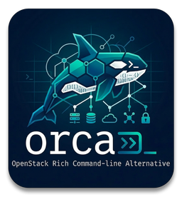

<p align="center">
  
</p>

<h1 align="center">orca</h1>

<p align="center">
  OpenStack Rich Command-line Alternative — a unified CLI for managing OpenStack cloud infrastructure.
</p>

<p align="center">
  <strong><a href="https://docs.orca.stackops.ch/">Full Documentation</a></strong>
</p>

## Highlights

- **100 % OSC parity** on the 10 core services (635/635 verbs).
  Drop-in replacement: `alias openstack=orca` and you're done.
  See [Coming from OSC](https://docs.orca.stackops.ch/from-osc/).
- **80+ top-level command groups** — every major OpenStack service
  (Keystone, Nova, Neutron, Cinder, Glance, Swift, Heat, Designate,
  Barbican, Placement, Octavia, Magnum, Manila, Gnocchi, Aodh,
  CloudKitty, Freezer) plus OSC-compatible admin top-levels
  (`block-storage`, `object-store`, `orchestration`, `software`,
  `coe`, `resource`, …).
- **Typed service layer** — every resource flows through a typed
  `*Service` class with TypedDict models, catching field-name
  typos at mypy time.
- **Rich terminal output** — coloured tables, trees, progress
  bars (Rich).
- **Multi-account profiles** — named profiles, `clouds.yaml` and
  `OS_*` env var support, transparent token caching.
- **Shell auto-completion** — Bash, Zsh, Fish, with per-profile
  resource caching.
- **Orca-exclusive commands** — `overview`, `find`, `audit`,
  `cleanup`, `watch`, `doctor`, `server diff`, `server clone`,
  `server bulk`, `server port-forward`, `subnet inspect`,
  `zone tree`, `stack topology`, …

## Quick Start

```bash
pip install orca-openstackclient
orca setup           # interactive credential setup
orca server list     # list your VMs
```

From source (development):

```bash
git clone https://github.com/stackopshq/orca-cli.git
cd orca-cli
poetry install --with dev
poetry run orca --help
```

Requires Python **3.10 – 3.15**.

## Commands at a glance

### Compute (Nova)
`server` · `server bulk` · `server clone` · `server diff` · `server port-forward` · `console` · `flavor` · `keypair` · `aggregate` · `hypervisor` · `availability-zone` · `compute-service` · `server-group` · `usage` · `limits` · `event`

### Networking (Neutron)
`network` · `port` · `router` · `subnet` · `floating-ip` · `security-group` · `subnet-pool` · `trunk` · `qos` · `address-group` · `address-scope` · `ip-availability` · `local-ip` · `extension`

### Storage
`volume` · `block-storage` · `image` (Glance) · `object` / `container` / `object-store` (Swift) · `share` (Manila) · `backup` (Freezer)

### Identity (Keystone)
`project` · `user` · `role` · `domain` · `group` · `credential` · `application-credential` · `endpoint` · `endpoint-group` · `service` · `region` · `policy` · `trust` · `token` · `auth` · `access-rule` · `limit` · `registered-limit` · `catalog` · `versions`

### Federation (Keystone)
`identity-provider` · `federation-protocol` · `mapping` · `service-provider`

### Platform services
`stack` / `orchestration` / `software` (Heat) · `loadbalancer` (Octavia) · `zone` / `recordset` / `tld` / `ptr` / `tsigkey` (Designate) · `secret` / `acl` / `ca` (Barbican) · `cluster` / `coe` (Magnum) · `metric` (Gnocchi) · `alarm` (Aodh) · `rating` (CloudKitty) · `placement` / `resource` / `trait` / `allocation`

### Orca-exclusive
`overview` · `find` · `audit` · `cleanup` · `watch` · `doctor` · `export` · `ip` · `quota` · `profile` · `setup`

## Documentation

Full documentation: **[docs.orca.stackops.ch](https://docs.orca.stackops.ch/)**

Local preview:

```bash
poetry install --with docs
mkdocs serve
```

Release notes: see [CHANGELOG.md](CHANGELOG.md).

Architectural decisions: [docs/adr/](docs/adr/).

## License

Apache-2.0
